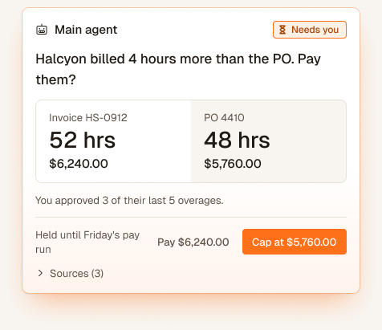
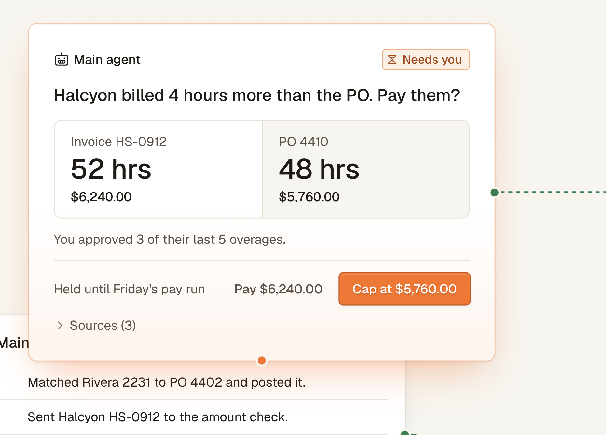
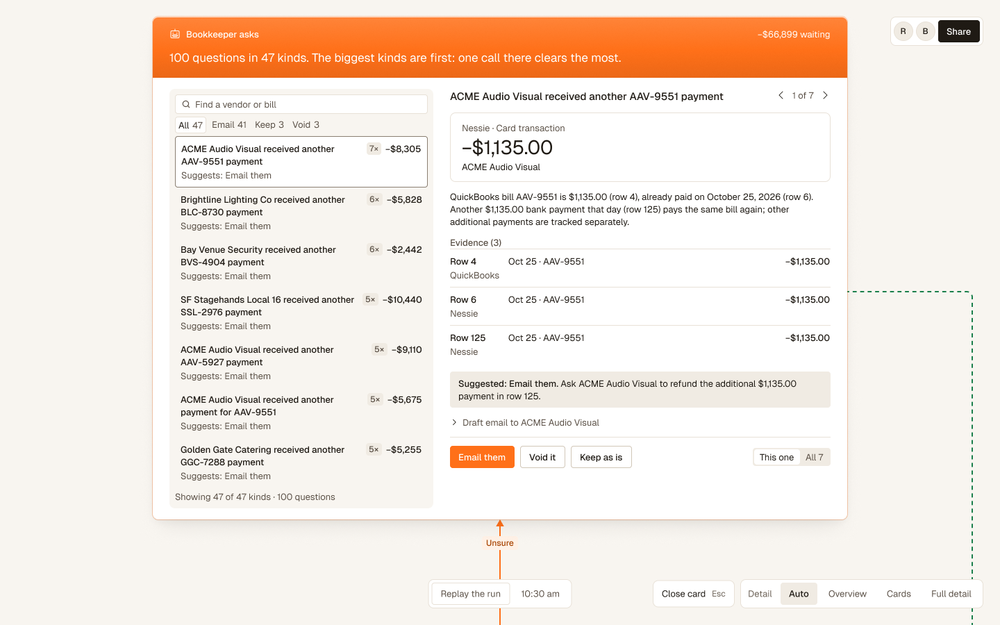
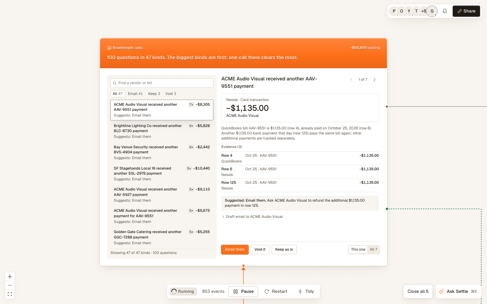

# Stage log: Pacioli

Pacioli does the books after a concert. AI agents sort every payment, match it to its bill and post it. You only check the ones they're not sure about.

- Figma file: https://www.figma.com/design/j5FmqSGsD6uUaGOeOq06GP (pages are numbered by stage)
- Figma Slides: https://www.figma.com/slides/e4vwifUeeOymRiDCOY6APj
- Name: it was called Settle until Saturday night. We renamed it Pacioli, after the guy who wrote down double-entry bookkeeping. The Figma file keeps the old name on purpose so you can see how we got here. The logo is on page "7 Logo: Pacioli".
- Repo: this one. Times come from git commits and Figma version history.
- Team: rahuchpred (design system, Figma, front end), AnSingh1 (SpacetimeDB backend, live canvas, Droid client).

We didn't go straight from design to code. We started the design system in Figma, built the canvas in code because the agents change it every second, then kept bringing Figma back to check the app. That back and forth is the workflow.

## 1. Ideation

**Tools:** Figma Design (page "1 Ideation: pipeline map"), Mobbin, context.dev for brand research.
**Why:** arguing over six boxes on a canvas was faster than arguing over a doc.
**Time:** about 20 min, Friday 7:40 to 7:59 PM. **Rating:** 4/5.
**Into the project:** that map became the six steps in the app (sources, agents, checks, asks you, pays, learns) and the layout of the canvas.
**Friction:** Mobbin had good finance screens but nothing for an agent asking a person to decide. We took that pattern from Glaze.

## 2. Prototyping

**Tools:** Figma Design for colors and components. Code for the live canvas.
**Why:** we wanted one set of colors and names for both Figma and code. The canvas needs live data, and Figma can't show agents moving, so we prototyped it in code.
**Time:** Friday 9:07 to 10:26 PM for the design system, then 8 canvas tries in code Saturday morning. We kept one.
**Rating:** 5/5 for the design system. 2/5 for the canvas.
**Into the project:** the color names in `design-system/src/tokens/tokens.json` match the Figma variables exactly.
**Dead end:** we drew a phone version and an A vs B theme board, then deleted both. It's a web app. Both are still in version history.

## 3. Handoff

**Tools:** Figma MCP, driven by Claude Code.
**Why:** after a day of coding, Figma no longer matched the app. Claude Code read our code and updated Figma itself.
**Time:** about 15 min, Saturday around 11:30 AM. **Rating:** 4/5.
**What we did:**
- Fixed the Status tag in Figma to match the code. It was still the old round pill.
- Rebuilt three app screens as 1440x900 frames from our own components, not screenshots.
- Made them clickable. Click Needs you to open the card, press Esc to go back.

**Into the project:** those frames are the prototype on page 4. Every later check reused their components.
**Friction:** our MCP couldn't screenshot a web page, so we rebuilt screens from components. Search couldn't find hidden layers inside instances, so we reset overrides. We couldn't save named versions through the MCP, so we saved them by hand. One script put a radius where a color goes. It failed and Figma undid it.

## 4. Code generation

**Tools:** Claude Code writing React with our design skill (`skills/settle-design/SKILL.md`), plus the Figma and Mobbin MCPs.
**Why:** the skill holds our design rules, so the code it writes already follows them.
**Time:** Friday 8:38 PM to Saturday 9:49 PM. **Rating:** 4/5.
**Into the project:** every check ended with a fix on whichever side was wrong, Figma or code.
**Check 1, Saturday 11:30 AM, 15 min:** Figma next to the app showed 4 differences. The code was ahead every time, so we fixed Figma.
**Check 2, Saturday 3:30 PM, 10 min:** code went first. We built 6 question cards in the app and kept 1.
**Check 3, Saturday 5:28 to 10:07 PM:** a teammate's merge broke 6 design rules. Claude Code logged each one on Figma page 6 with the file and line. One commit fixed most of them, and the recheck caught one coming back. Then we rebuilt the new screens in Figma.
**Before and after:** Figma once drifted for a day before we noticed. By Saturday night, a broken merge got logged in 72 minutes.

| Figma frame | Running app |
|---|---|
|  |  |
|  |  |
|  |  |
|  |  |
|  |  |

**Friction:** a color variable ignored its opacity. New frames came with a white fill that hid the orange band.

## Do it yourself

1. Keep your colors in one file and use the same names in Figma.
2. Build the fast-changing stuff in code. Every few hours, have the agent rebuild key screens in Figma from your components.
3. Put each Figma frame next to a screenshot of the app at the same size. Fix whichever one is wrong.
4. Only prototype the moment a person decides, and test it on someone outside the team.
5. After every merge, check the whole app again, not just the files you fixed.
