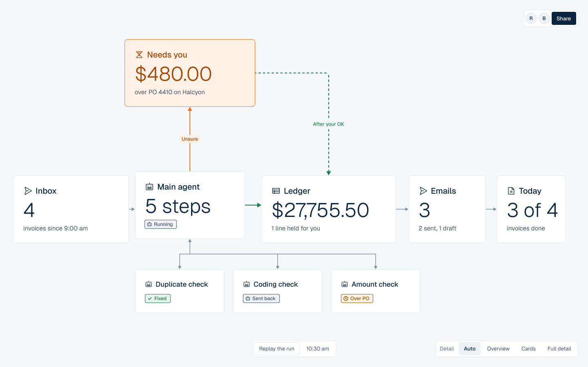
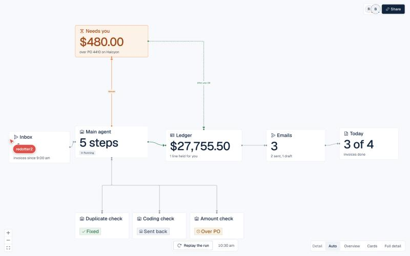
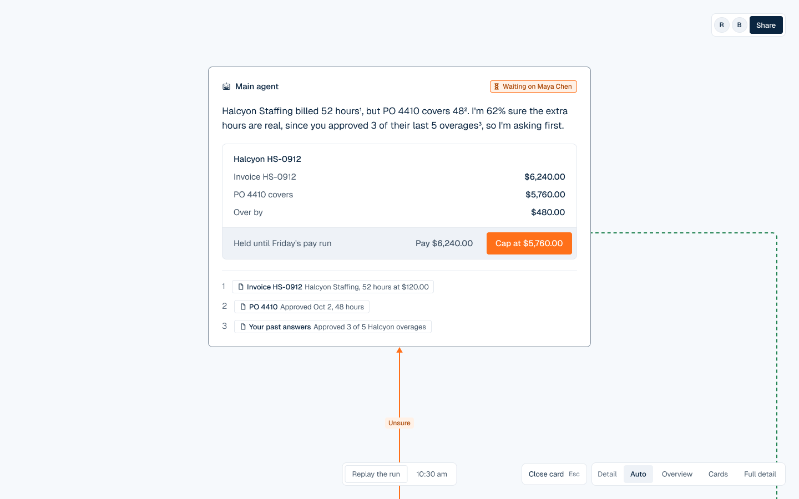
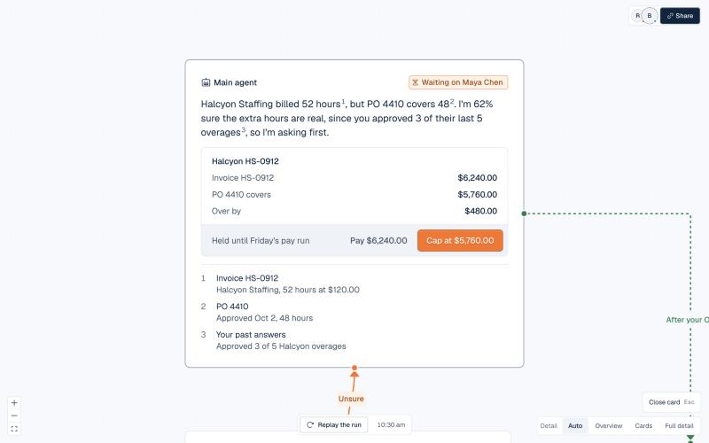
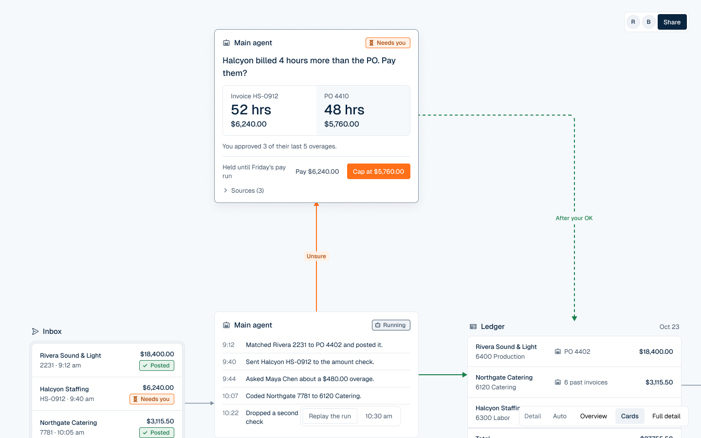
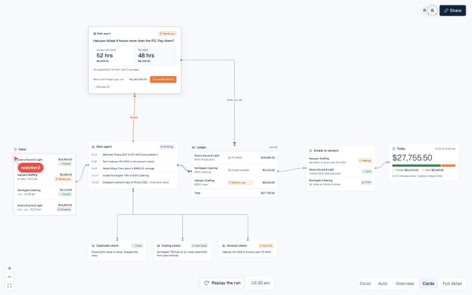

# Stage log: Settle

Settle runs show settlement for concert promoters. Agents read invoices, check them and post them; a person only sees the calls the agents are unsure about.

- Figma file: https://www.figma.com/design/j5FmqSGsD6uUaGOeOq06GP (pages are numbered by stage)
- Repo: this one. Times come from git commits and Figma version history.
- Team: fill in names. Items marked **(confirm)** are not in any record yet.

Our real path was not a straight line. We started the design system in Figma, built the canvas in code because the agents' work changes every second, then brought Figma back to check the shipped screens and to prototype the decision. That loop is the workflow we would reuse.

## 1. Ideation

**Tools:** Figma Design (page "1 Ideation: pipeline map"), Mobbin, context.dev for brand research.
**Why:** a map of the six steps (sources, agent seats, controls, escalate, settle, learn) was faster to argue about on a canvas than in a doc.
**Time:** about 30 min **(confirm)**. **Rating:** 4/5.
**Into the project:** the map became the six-step pipeline in `AGENTS.md` and the node layout of the canvas.
**Friction:** Mobbin found good finance and agent screens, but none for "agent hands a decision to a person", so that pattern came from Glaze on design.how.

## 2. Prototyping

**Tools:** Figma Design for the system; code for the canvas; then Figma prototype for the decision flow.
**Why:** tokens and components needed one source of truth for both sides. The canvas itself needed live data, so we prototyped it in code.
**Time:** Friday 21:07 to 22:26 design system and themes (git). Saturday morning, eight canvas versions in code, narrowed to one.
**Rating:** Figma for the system 5/5. Figma for a live canvas 2/5, it cannot show agents moving.
**Into the project:** `design-system/src/tokens/tokens.json` uses the same names as the Figma variables (Color, Space, Radius, Accent).
**Friction:** we drew a phone prototype and an A vs B theme comparison, then deleted both on Saturday because the product is web only. Dead end, kept in version history.

## 3. Handoff

**Tools:** Figma MCP (official connector) driven by Claude Code.
**Why:** after a day of code changes, Figma had drifted from the app. The MCP let the agent read the code and update Figma directly.
**Time:** about 15 min, Saturday ~11:30. **Rating:** 4/5.
**What happened:**
- Synced the Status component to the code: 4px rectangle, icon first, hairline in its own color (it was still the old round pill).
- Rebuilt the app's three views as 1440x900 frames from our components and variables, not screenshots: Overview, Cards (real size, scrolls like the canvas, controls pinned) and "Needs you, open".
- Wired a clickable prototype: the Detail filter switches Overview and Cards, clicking "Needs you" opens the card, Close card or Esc goes back.
**Friction:** the MCP has no capture-a-web-page tool in our setup, so frames were rebuilt from components. Hidden layers inside instances could not be found by search; we had to reset overrides. Saving a named version is blocked through the MCP, so a person saves the checkpoints. One script bound a radius variable where a color belonged and failed; Figma rolled it back cleanly.

## 4. Code generation

**Tools:** Claude Code writing React, with the Settle agent skill (`skills/settle-design/SKILL.md`) and the Figma MCP for checks.
**Why:** the skill holds the design rules, so generated code follows the system without us repeating them.
**Time:** most of the build **(confirm hours)**. **Rating:** 4/5.
**Check against Figma:** we put each Figma frame (exported through the MCP) next to the running app. First pass found 4 differences, all where the code had moved ahead: Inbox reads "4" over "invoices since 9:00 am", Running is a status tag, the dock lost its version picker, and the app gained a Share button. We updated Figma to match.

| Figma frame | Running app |
|---|---|
|  |  |
|  |  |
|  |  |

Still different: the Figma Citation component draws sources as inline chips; the app lists them on two lines. The app's Cards level fits the whole canvas on screen at small size; the Figma frame shows it at real size and scrolls, because tiny text makes a poor design file. The short card's deadline text wraps in both.

## Run this yourself

1. Keep tokens in one JSON file and mirror the names as Figma variables.
2. Build fast-changing UI in code. Every few hours, ask the agent to rebuild the key screens in Figma from your components through the Figma MCP.
3. Export each Figma frame and screenshot the app at the same size. List every difference, decide which side is right, fix the other.
4. Prototype only the moment a person decides, in Figma, and test it on someone outside the team.
